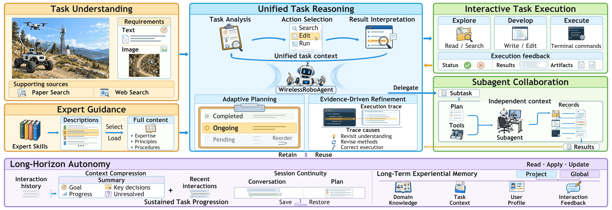
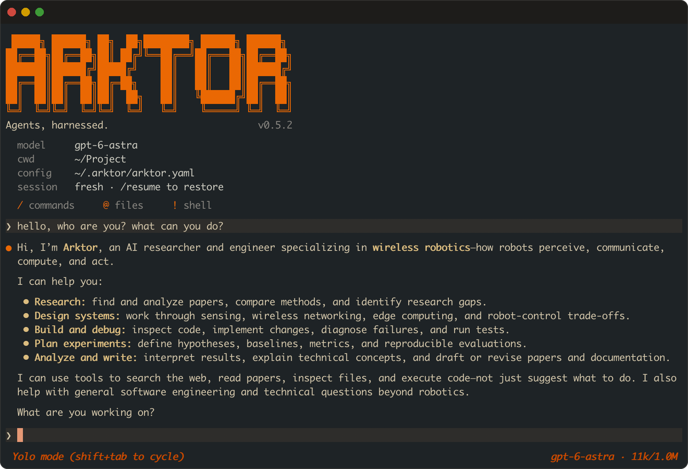

<h1 align="center">WirelessRoboAgent</h1>

<h2 align="center">A Unified Agent Framework for Wireless Robotics</h2>

<p align="center">
  <a href="https://github.com/ygyang11/WirelessRoboAgent"></a>
  <a href="pyproject.toml"></a>
  <a href="LICENSE"></a>
</p>

WirelessRoboAgent is a unified agent framework for diverse wireless robotics
tasks, presented in *Agentic AI and Benchmarking for Intelligent Wireless Robotics*.
Its software implementation, **Arktor**, combines *ark* with the agentive suffix
*-tor*, reflecting the goal of bringing knowledge, capabilities, and experience
together to support sustained research.

## Framework

[](docs/images/wirelessroboagent.png)

- **Unified Reasoning and Adaptive Refinement.** Maintains task-level reasoning
  in a unified context, revises explicit plans as understanding develops, and
  uses execution evidence to refine models, methods, and implementations.

- **Task-Adaptive Capability Augmentation.** Combines paper and web search,
  expert guidance, and interactive task execution with main-agent coordination
  and on-demand assistance from subagents with independent contexts.

- **Long-Horizon Autonomy.** Uses context compression and session continuity
  to sustain task progress, and project and global memory to retain experience
  for reuse across tasks.

## Getting started

### Installation

Install the CLI with its built-in tools:

```bash
git clone --branch research/wireless-robo-agent \
  https://github.com/ygyang11/Arktor.git
cd Arktor
conda create -n arktor python=3.11
conda activate arktor
python -m pip install -e ".[cli,app]"
```

### Configuration

From the repository root, create a user configuration:

```bash
mkdir -p ~/.arktor
cp arktor_example.yaml ~/.arktor/arktor.yaml
```

Set the model and credentials under `llm`:

```yaml
llm:
  provider: openai
  model: "__SET_MODEL__"
  api_key: "__SET_API_KEY__"
  base_url: "__SET_BASE_URL__"
```

Use `openai` for OpenAI-compatible services or `anthropic` for Anthropic.
A working-directory `arktor.yaml` takes priority over `~/.arktor/arktor.yaml`.
See [arktor_example.yaml](arktor_example.yaml) for specific settings.

## Usage

Start the agent in your research workspace:

```bash
arktor
```

Describe the wireless robotics problem, including its operating conditions,
objectives, and constraints. The agent draws on relevant capability to develop system
models and methods, implement and evaluate solutions, and interpret results.
Execution feedback guides revisions to task understanding, design choices,
and implementation.

<p align="center">
  
</p>

To evaluate agents on the 60 wireless robotics tasks, use
[WirelessRoboBench](https://github.com/ygyang11/Arktor-Bench-SelfEvolution/tree/research/wireless-robo-agent).

## Citation

For the paper citation, see the [paper repository](https://github.com/ygyang11/WirelessRoboAgent#citation).

## License

Released under the [MIT License](LICENSE).
