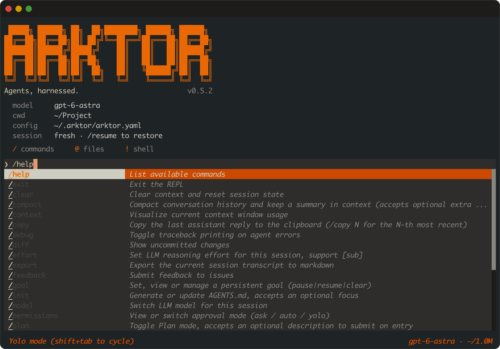

<p align="center">
  
</p>

<h2 align="center">Arktor：面向 CLI 与研究项目的 Agent Harness</h2>

<p align="center">
  <a href="https://github.com/ygyang11/Arktor/actions/workflows/ci.yml"></a>
  <a href="pyproject.toml"></a>
  <a href="LICENSE"></a>
  <a href="README.md"></a>
</p>

Arktor 是一个可扩展的 Agent Harness。既可直接通过 **CLI** 使用，
也可通过 **Python SDK** 进行项目构建和定制 Agent。

<p align="center">
  
</p>

## 特性

### Agent 能力

- **Agent 与工作流。** 提供 ReAct、Plan-and-Execute 和 Conversational Agent，
  支持 Pipeline、DAG、Router 和 Team 等工作流。

- **工具。** 内置文件操作、终端执行、网页与论文检索和读取、
  Skill、待办管理及文档解析等工具。

- **任务委派与后台执行。** 通过具有独立上下文的 sub-agent 处理子任务，
  可分别配置其工具和模型。命令与 sub-agent 均支持后台运行。

### Harness 设计

- **上下文与会话延续。** 支持加载多类指令、压缩上下文、恢复会话与工作状态，
  通过项目级和全局记忆积累跨会话信息，并支持持续跟踪长期任务目标。

- **执行控制。** 支持审批模式、资源访问规则、工具并发与超时设置等，
  可选用 Docker sandbox 隔离终端执行。

- **模型与多模态输入。** 支持 OpenAI 兼容服务、Anthropic、自定义 endpoint，
  以及独立的 sub-model 配置；可根据服务商和模型的支持情况输入图片与 PDF。

- **可观测性。** 跟踪工具执行与 token 用量，通过 Hook 接入生命周期事件，
  并支持 console 与 JSONL tracing。

## 快速开始

### 安装

从源码安装 CLI 与内置工具：

```bash
git clone https://github.com/ygyang11/Arktor.git
cd Arktor
conda create -n arktor python=3.11
conda activate arktor
python -m pip install -e ".[cli,app]"
```

<details>
<summary>可选依赖</summary>

| 扩展 | 内容 |
| --- | --- |
| `cli` | 终端界面依赖。 |
| `app` | 网页搜索、内容提取与文档解析等工具依赖。 |
| `sandbox` | 终端隔离执行所需的 Docker 客户端，需运行 Docker daemon。 |
| `dev` | 测试、代码检查与类型检查工具。 |

</details>

### 配置

将 CLI 配置放在 `~/.arktor/arktor.yaml`，便于在多个项目中复用。
在仓库根目录执行：

```bash
mkdir -p ~/.arktor
cp arktor_example.yaml ~/.arktor/arktor.yaml
```

如需单独配置某个项目，可在工作目录放置 `arktor.yaml`，CLI 会优先读取此文件。

在 `llm` 下设置模型与凭据。OpenAI 兼容服务使用 `openai`，Anthropic 使用 `anthropic`：

```yaml
llm:
  provider: openai
  model: "__SET_MODEL__"
  api_key: "__SET_API_KEY__"
  base_url: "__SET_BASE_URL__"
```

可用配置见 [arktor_example.yaml](arktor_example.yaml)，
环境变量见 [.env_example](.env_example)。

## CLI

### 交互式使用

启动交互式会话：

```bash
arktor
```

输入任务后，即可在终端跟踪 Agent 的执行过程。使用 `@path` 引入文件、
`!command` 执行 shell 命令，通过 `AGENTS.md` 或 `CLAUDE.md` 提供项目指令。

| 任务 | 命令 |
| --- | --- |
| 查看上下文与用量 | `/context`, `/usage`, `/compact` |
| 选择模型 | `/model`, `/provider`, `/effort` |
| 持续推进目标 | `/goal <objective>` |
| 选择审批模式 | `/permissions` |
| 规划与审查改动 | `/plan`, `/review`, `/diff` |
| 管理会话 | `/resume`, `/new` |

使用 `/help` 查看全部交互命令。

### 非交互式运行

通过 `-p` 执行任务并在完成后退出：

```bash
arktor -p "Inspect this repository and summarize its architecture."
```

添加 `--output-format json` 可输出 NDJSON，包含执行步骤事件和最终结果。
使用 `arktor --help` 查看启动选项。

## Python SDK

### 构建 Agent

使用 SDK 为自己的项目与实验构建 Agent 和工作流。
以下示例为 Agent 添加一个测量数据汇总工具，并读取上文创建的用户配置：

```python
import asyncio
import json
from pathlib import Path

from agent_harness import HarnessConfig, ReActAgent, tool


@tool
def summarize_measurements(values: list[float]) -> str:
    """Summarize numeric measurements.

    Args:
        values: Measurements to summarize.
    """
    if not values:
        return "No measurements provided."
    return json.dumps({
        "count": len(values),
        "mean": sum(values) / len(values),
        "min": min(values),
        "max": max(values),
    })


async def main():
    agent = ReActAgent(
        name="analyst",
        tools=[summarize_measurements],
        config=HarnessConfig.load(Path.home() / ".arktor" / "arktor.yaml"),
    )
    result = await agent.run(
        "Use summarize_measurements to summarize [1.8, 2.1, 2.0, 2.3]."
    )
    print(result.output)
    print(f"Tokens used: {result.usage.total_tokens}")


asyncio.run(main())
```

`@tool` 根据类型注解和 docstring 自动生成工具 schema。
返回的 `AgentResult` 包含最终输出、执行步骤与 token 用量。

### 组合与扩展

Arktor 将 Agent 的核心设计、工具能力与终端交互组织为三个层次：

| 包 | 职责 |
| --- | --- |
| [agent_harness](src/agent_harness/) | 定义 Agent 行为与底层设计的核心抽象与 runtime。 |
| [agent_app](src/agent_app/) | 为 Agent 提供任务能力的可复用工具与资源。 |
| [agent_cli](src/agent_cli/) | 将核心机制与工具集成到终端，支持交互式和脚本调用。 |

可以基于现有层次继续构建，也可以按需修改组件及其组合方式。
可从示例与源码入手，探索自己的方法与实验。

### 示例

示例脚本读取仓库根目录的 `arktor.yaml`。
如需复用用户配置，运行前将其复制到仓库根目录：

```bash
cp ~/.arktor/arktor.yaml arktor.yaml
python examples/agents/react_agent.py
```

- **Agent 模式：** [ReAct](examples/agents/react_agent.py) 与
  [Plan-and-Execute](examples/agents/plan_and_execute.py)。
- **多 Agent 工作流：** [Pipeline 与 DAG](examples/agents/multi_agent_pipeline.py)、
  [Team](examples/agents/agent_team.py) 与 [Deep Research](examples/agents/deep_research.py)。
- **工具与状态：** [编程工具](examples/features/coding_demo.py)、
  [会话](examples/features/session_demo.py)与 [Skill](examples/features/skill_demo.py)。

## 引用

引用 Arktor 时，可使用以下条目或 [CITATION.cff](CITATION.cff)。

```bibtex
@software{arktor,
  author = {{ygyang11}},
  title  = {Arktor},
  url    = {https://github.com/ygyang11/Arktor}
}
```

## 许可证

本项目采用 [MIT License](LICENSE)。
